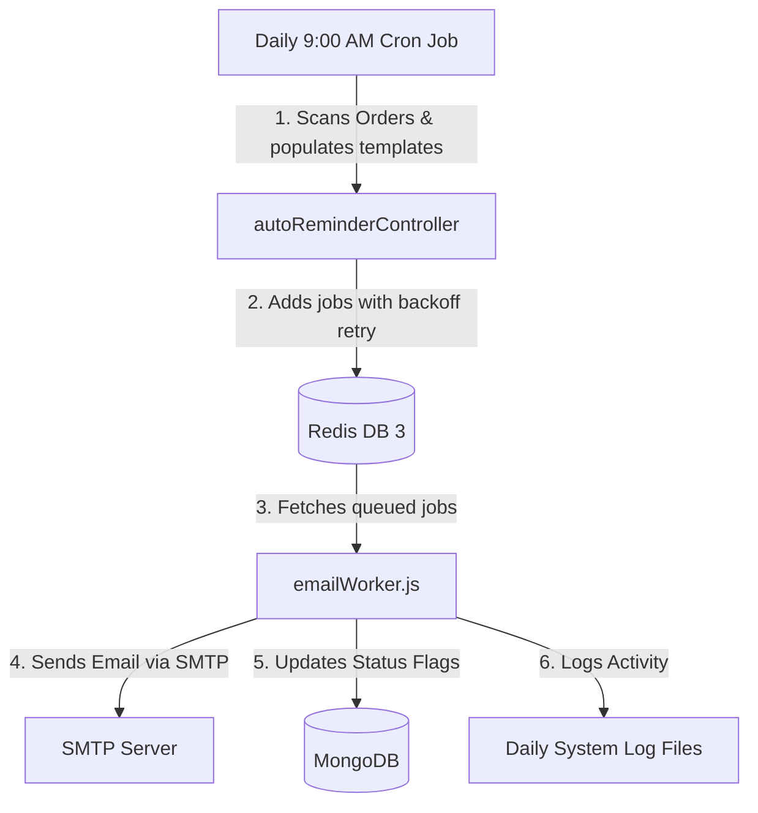

# Billing System Backend documentation

This repository contains the backend service for the Billing, Invoice, and Automated Reminder system. It includes features for automated customer reminders (via BullMQ and Redis), system activity logging, and database backup/restore utilities.

---

## 📂 Database Backup & Restore Utility

A utility script (`dbBackupRestore.js`) is provided at the root of the backend directory to export and import all database collections (Admins, Customers, Products, Invoices, Templates, SMTP, and GST Settings).

### 1. How to Backup the Database
To export the current database state to a JSON backup file:
```bash
node dbBackupRestore.js --backup
# OR
node dbBackupRestore.js -b
```
* **Storage Location:** Backups are saved in the `./backups/` directory with a timestamped filename, e.g., `backup_2026-07-02T05-45-00.json`.
* **Output:** Statistics showing the count of records exported for each collection.

### 2. How to Import/Restore the Database
To restore database collections from an existing JSON backup:
```bash
node dbBackupRestore.js --import <filename_or_path>
# OR
node dbBackupRestore.js -i <filename_or_path>
```
* **Usage Examples:**
  ```bash
  # Restore using a file inside the backups folder:
  node dbBackupRestore.js --import backup_2026-07-02T05-45-00.json
  
  # Restore using an absolute/relative file path:
  node dbBackupRestore.js -i C:/Sridhar/Billing/backend/backups/backup_2026-07-02T05-45-00.json
  ```
> [!WARNING]  
> Restoring a backup will **delete and overwrite** all existing records in the database. Ensure you back up your current data first if you wish to preserve it.

---

## ⚙️ Automated Reminder & Email Queue System

The automated reminders notify customers of upcoming renewals, expired services, and pending service deletions.

### System Architecture Workflow


1. **Daily Cron Trigger:**
   A scheduled task runs every day at **9:00 AM** via `node-cron` in `server.js` (`0 9 * * *`). It calls the controller function `runAutoReminderCron` in `backend/controllers/autoReminderController.js`.
2. **Evaluating Renewal Status:**
   The controller scans all customer orders to check eligibility based on the `endDate`:
   * **Renewal:** Sent `X` days before `endDate`.
   * **Expired:** Sent if `endDate` has passed.
   * **Deletion Warning:** Sent `Y` days after `endDate` has passed.
3. **Queueing Jobs:**
   For each matched customer and order, a job is dispatched to the BullMQ `emailQueue` on Redis. This decouples the cron script from the network overhead of sending SMTP emails.
4. **Processing (Worker):**
   The BullMQ `emailWorker` pulls jobs from the queue. It sends the email utilizing the SMTP credentials, updates the database status flags (`emailSend`, `expiredEmailSend`, `deletionEmailSend`) to prevent duplicate reminders, and writes logs to the daily `.log` file.

---

## 🚀 How to Run the Services

### Prerequisites
1. **MongoDB:** Make sure the MongoDB instance is online and running.
2. **Redis:** A Redis server is required. Based on the environment, it uses a Unix Socket:
   * Socket Path: `/home/jayam/.redis/redis.sock`
   * Database: `3` (used by BullMQ)

### 1. Start the API Server & Cron Scheduler
Run the server to handle API requests and initialize the daily 9:00 AM reminder checker.
```bash
# From backend directory
npm run dev
```

### 2. Start the Email Worker
The email queue worker runs as a separate background process. It must be active to process the queued reminder jobs.

#### For Development:
Run the worker in a separate terminal:
```bash
node workers/emailWorker.js
```

#### For Production (Background/Daemon mode):
To ensure the worker runs continuously in the background, use a process manager like **PM2**:
```bash
# Install PM2 globally if not installed
npm install -g pm2

# Start the worker process
pm2 start workers/emailWorker.js --name "billing-email-worker"

# Check worker status
pm2 status
```
*Alternatively, you can run it using `nohup`:*
```bash
nohup node workers/emailWorker.js > workers.log 2>&1 &
```

---

## 🛠️ Diagnostics & Manual Testing Commands

### Manually Send Apologies and Reset Flags
If test emails were sent incorrectly during staging or debugging, run this script to send apology/correction emails to affected customers and reset their database flags:
```bash
node send-apologies.js
```

### Checking System Logs
Activity status (such as `START`, `SENT`, `QUEUED`, `ERROR`, `DONE`) is written to daily files inside the `./logs/` directory:
```bash
# Logs are named by date, e.g.
backend/logs/2026-07-02.log
```


### If Invoice not Send To in Server follow this commands 
[jayam@panel ~]$ cd domains/webscape.co.in/billing-backend
[jayam@panel billing-backend]$ npm puppeteer browsers install chrome
Unknown command: "puppeteer"

To see a list of supported npm commands, run:
  npm help
[jayam@panel billing-backend]$ npx puppeteer browsers install chrome
sh: line 1: /home/jayam/domains/webscape.co.in/billing-backend/node_modules/.bin/puppeteer: Permission denied
[jayam@panel billing-backend]$ ls -l node_modules/.bin/puppeteer
-rw-r--r-- 1 jayam jayam 427 May 23 11:37 node_modules/.bin/puppeteer
[jayam@panel billing-backend]$ chmod +x node_modules/.bin/puppeteer
[jayam@panel billing-backend]$ ls -l node_modules/.bin/puppeteer
-rwxr-xr-x 1 jayam jayam 427 May 23 11:37 node_modules/.bin/puppeteer
[jayam@panel billing-backend]$ npx puppeteer browsers install chrome


Result: 122 unique customers, 138 orders total (not 124 — a few rows share the same email/phone and correctly merge into one customer as repeat orders, e.g. "royal solution" has 3 rows → 1 customer, 3 orders).
One customer, M. Viswanathan (row 140), has no Product/Price/Order Date filled in at all — so they'll import fine as a customer profile but with zero orders. Worth checking if that row is missing data by mistake.
I've generated the exact JSON your script would insert into MongoDB (all 122 customer documents with parsed orders, products, dates, payments) so you can verify it before running it against your live DB:


db.customers.updateMany(
  {},
  [
    {
      $set: {
        orders: {
          $map: {
            input: "$orders",
            as: "order",
            in: {
              $mergeObjects: [
                "$$order",
                {
                  orderDate: {
                    $arrayElemAt: [
                      "$$order.products.createdDate",
                      0
                    ]
                  }
                }
              ]
            }
          }
        }
      }
    }
  ]
);


1. Same domain used by two different customer records
This is the most important issue — these look like duplicate customer entries for the same actual business:
DomainCustomer recordsprecimacengineering.com"precima" and "precimacengineering"masassemblytech.com"ganesh" and "masassemblytech"madhanpackagingmachineries.co.in"madhanpackaging" and "madhanpackagingmachineries"spydosecurity.com"spydo" and "spydosecurity"transindiasolutions.com"trans india solutions" (×2 — same name too)kikview.in"falcon service" and "kikview"mcmbls.in"mcmbls" and "dribumcmbls" (listed twice in dribumcmbls's own order too)balwantsteel.com"bal want steel" and "balwantsteel"indianwindpowerassociation.com"indianwindpowerassociation" and "indian wind"balajilogisticschennai.com"balajilogisticschennai" and "balaji logistics"jayam.co.in"jayamwebsolutions" and "jayam"
2. Same customer name appearing twice

"trans india solutions" — two separate _id records, same phone (9884204622), same domain, different emails
"jayamwebsolutions" — two separate _id records, different phone/email, but same-ish domain family

3. Same email used across two different customer records

madhan@madhanpackaging.com → used by both "madhan" and "madhanpackaging"

4. Same phone number across different customer records

8056252363 → "madhan" / "madhanpackagingmachineries"
7200093119 → "spydo" / "spydosecurity"
1234567890 → "royal solution" / "sridhar" (likely a placeholder number, not meaningful)
9884204622 → both "trans india solutions" entries
9791075779 → "mcmbls" / "dribumcmbls"
8056124354 → "bal want steel" / "balwantsteel"
9884046126 → "balajilogisticschennai" / "balaji logistics"

5. Duplicate domain entries within a single customer's own order list
These aren't cross-customer duplicates but repeated line items for the same customer:

royal solution — royalsolution.org appears twice
bal mech — arovinengg.com appears twice
atomtd — atomtd.com appears twice
nsk-industries — nsk-industries.com appears twice
dribumcmbls — mcmbls.in appears twice
sridhar — jayam.com appears twice
ponu kumar — voltampfacilities.in vs "Voltampfacilities.in" (case-only difference)


# BillingBackend

